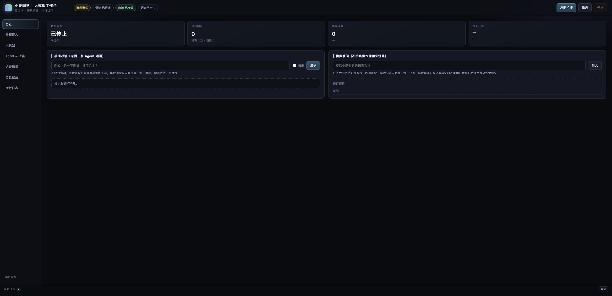
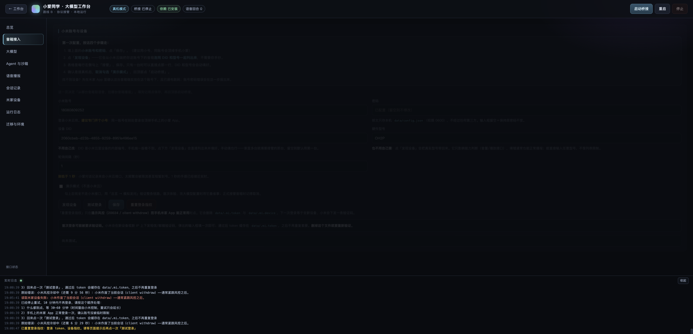
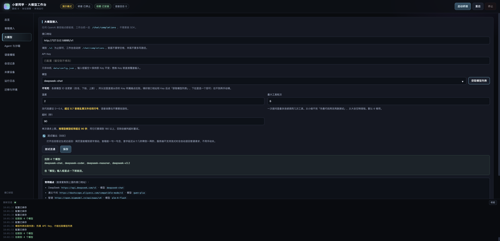
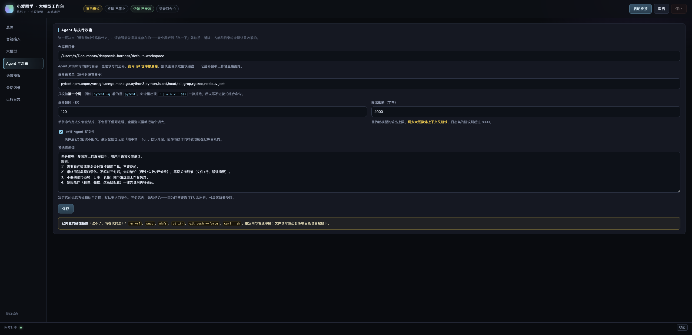
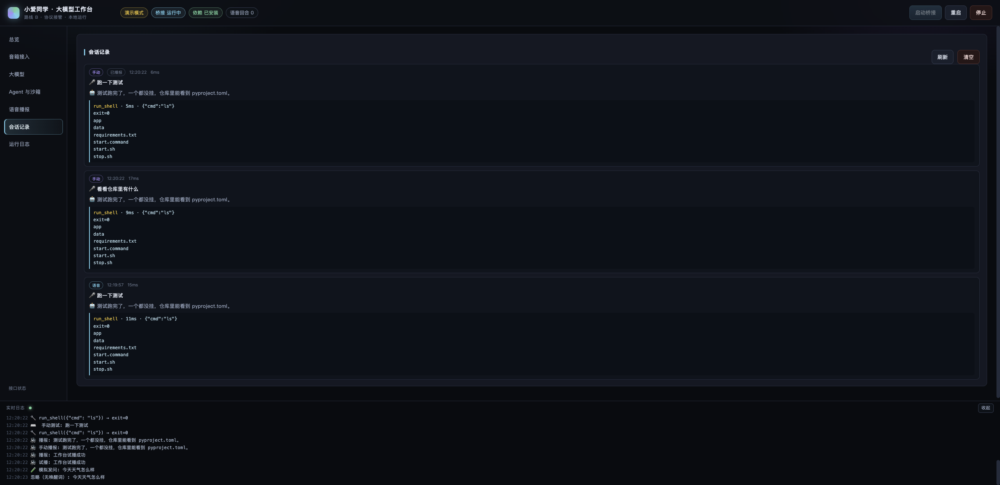
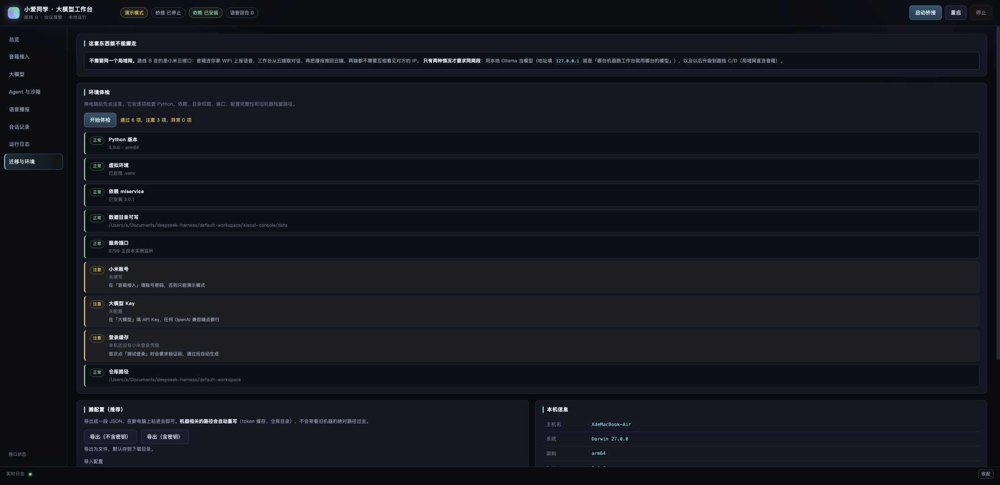
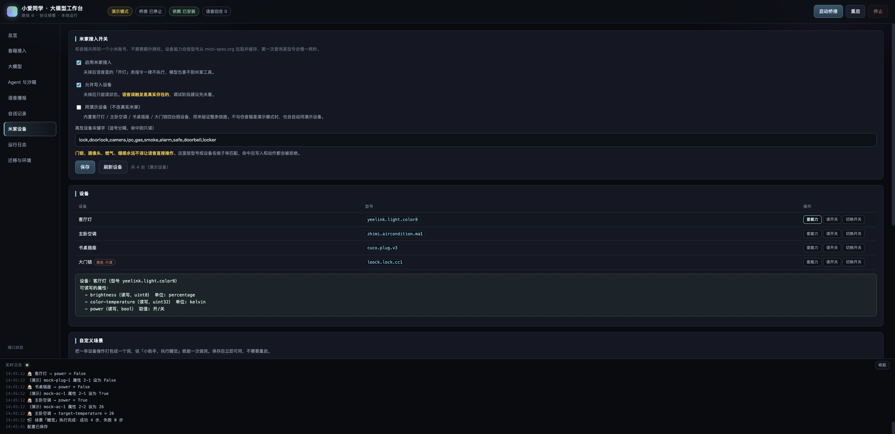
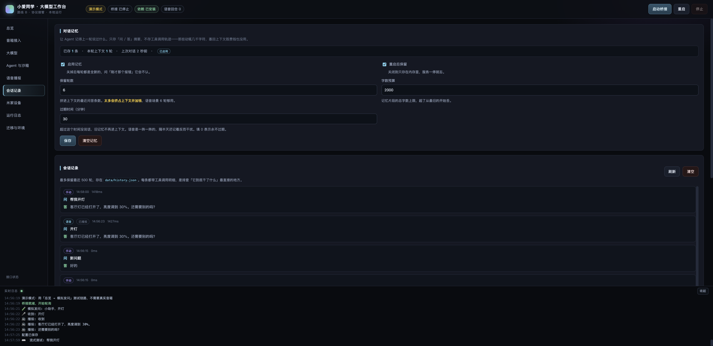

# 小爱同学 · 大模型工作台

[](https://github.com/YiIimini/xiaoai-console/actions/workflows/test.yml)
[](https://www.python.org/)
[](LICENSE)
[-brightgreen)](requirements.txt)

路线 B（协议接管）的本地一键启动管理工作台。不拆机、不刷固件，用小米云会话把音箱接到任意 OpenAI 兼容大模型上，并可挂工具做**语音调试 / 语音改代码**。

```
说话 → 小爱 ASR → 云端会话记录 → 工作台轮询 → 唤醒词命中 → Agent（大模型+工具）→ TTS 播报
```

## 一键启动

```bash
cd xiaoai-console
./start.sh          # macOS / Linux，或双击 start.command
start.bat           # Windows 双击
```

脚本是**幂等的一键安装**：找 Python 3.9+ → 建 `.venv` → 装 `miservice`（默认源失败自动切清华/阿里/中科大镜像）→ 挑空闲端口 → 起服务 → 开浏览器。重复运行不会重装。

```bash
./start.sh doctor   # 只做环境体检，不启动
./stop.sh           # 停止
XIAOAI_PORT=8899 ./start.sh   # 指定端口
./pack.sh           # 打包成可搬运的 zip（默认 52 KB）
```

全新机器实测：解压 → `./start.sh` → 自动建 venv、装依赖、起服务，约 20 秒可用。

## 界面

| 总览 | 音箱接入 |
|---|---|
|  |  |

| 大模型 | Agent 与沙箱 |
|---|---|
|  |  |

| 会话记录（含工具调用轨迹） | 迁移与环境 |
|---|---|
|  |  |

| 米家设备与自定义场景 | 对话记忆 |
|---|---|
|  |  |

## 三个高频问题

**Q1：音箱要和跑工作台的机器在同一个局域网吗？**

不需要。路线 B 走的是小米云接口——音箱连它自己的 WiFi 上报语音，工作台从云端取对话、再把播报推回云端，两端不需要互相看见对方的 IP。放在云服务器、公司电脑、家里 NAS 上都一样。

只有两种情况要求同网段：

- 用本地 Ollama 当模型（地址填 `127.0.0.1`，含义是「哪台机器跑工作台就用哪台的模型」；想连另一台的 Ollama 就把 `127.0.0.1` 换成那台的局域网 IP，并在那台上设 `OLLAMA_HOST=0.0.0.0`）
- 以后升级到路线 C（刷机）/ D（ESP32 自建），那是局域网直连

**Q2：换电脑了怎么办？**

三种搬法，从省事到干净：

| 方式 | 操作 | 保留什么 |
|---|---|---|
| **整目录复制** | 把 `xiaoai-console` 整个文件夹拷过去，**删掉 `.venv`**，再跑 `./start.sh` | 代码 + `data/config.json` + 历史 + 登录缓存 |
| **只搬配置** | 新机器解压 → `./start.sh` → 「迁移与环境 → 导出/导入」 | 所有设置，凭据可选 |
| **重新填** | 账号密码、Key 各填一次 | 无 |

关键点：

- **`.venv` 绝对不能拷**——里面写死了旧机器的 Python 绝对路径，换机必坏，删掉让脚本重建
- 工作台会自动重写机器相关路径：`data/.mi.token` 存的是相对路径，`agent.repo` 如果在新机器上不存在，导入时会自动改成项目上级目录
- 小米登录缓存在 `data/.mi.token`，搬到新机器**仍然有效**；但如果之前删过，就要重新走一次验证码

**Q3：在其它电脑上能一键装好吗？**

能，但有两个前提：**装了 Python 3.9+**、**能联网**（装 `miservice` 那一下）。

- 没 Python：macOS 装完 Xcode 命令行工具自带 `python3`，或 `brew install python@3.12`；Windows 去 python.org 装并勾选 *Add python.exe to PATH*
- 没网：工作台照样启动，自动进「演示模式」，用「模拟发问」能验证大模型+工具链路，只是接不了真机。联网后重跑 `./start.sh` 就补上依赖
- 端口被占：自动后移，实际端口写在 `data/port`
- 想知道到底哪儿不对：`./start.sh doctor` 或界面的「迁移与环境 → 开始体检」，9 项逐条给结论和修法

## 首次使用（三种模式）

| 场景 | 操作 |
|---|---|
| **只想先看界面跑通** | 「音箱接入」勾选 **演示模式** → 保存 → 启动桥接 → 总览页「模拟发问」输入 `小助手，跑一下测试` |
| **接真音箱** | 填小米账号密码 → 「发现设备」点一行填入 DID → 保存 → 启动桥接 |
| **接大模型** | 「大模型」填 base_url / api_key / model → 「测试连通」→ 保存 |

依赖缺失或离线时自动降级为演示模式，界面照常可用。**全新安装默认就是演示模式**，接真机时到「音箱接入」取消勾选即可。

## 常用模型端点

| 服务 | base_url | 模型名示例 |
|---|---|---|
| DeepSeek | `https://api.deepseek.com/v1` | `deepseek-chat` |
| 通义千问 | `https://dashscope.aliyuncs.com/compatible-mode/v1` | `qwen-plus` |
| 智谱 | `https://open.bigmodel.cn/api/paas/v4` | `glm-4-flash` |
| 月之暗面 | `https://api.moonshot.cn/v1` | `moonshot-v1-8k` |
| 本地 Ollama | `http://127.0.0.1:11434/v1` | `qwen2.5:7b` |

## 工作台功能

- **状态总览**：桥接状态、语音回合、轮询次数、错误计数、最近一问一答、最近播报
- **手动对话**：不走音箱，直接测 Agent 通道，可选是否播报
- **模拟发问**：注入一句「语音」，整条链路与真机一致（演示模式 / 调试用）
- **音箱接入**：账号、DID、硬件型号、轮询间隔、设备发现、登录诊断、验证码弹框
- **大模型**：端点、Key、模型、温度、工具轮次上限、超时、连通测试
- **Agent 与沙箱**：仓库根目录、命令白名单、超时、输出截断、写文件开关、系统提示词
- **记忆**

| 配置项 | 注意 |
|---|---|
| 启用记忆 | 关掉后每轮全新，「刚才那个报错」它不认 |
| 重启后保留 | 关闭则只在内存里，服务一停就忘 |
| 保留轮数 | **太多会挤占上下文并加钱**，语音场景 6 轮够用 |
| 字数预算 | 记忆片段总字数上限，超了从最旧的丢 |
| 过期时间 | 隔半天还记着反而干扰；填 0 永不过期 |

**米家**

| 配置项 | 注意 |
|---|---|
| 启用米家接入 | 关掉后模型拿不到米家工具，语音里的「开灯」不会执行 |
| 允许写入设备 | 关掉只读。**调试阶段建议先关着**，语音误触发是真实存在的 |
| 演示设备 | 内置 4 台假设备；不勾但音箱是演示模式时也会自动用假的 |
| 高危设备关键字 | 门锁/摄像头/燃气/烟感**永远不该让语音直接操作**，命中即只读 |

**语音播报**：唤醒词表、播报字数上限、连续对话窗口、应答语、试播
- **会话记录**：每条含工具调用参数与结果、耗时、是否已播报
- **运行日志**：SSE 实时流，底部常驻 + 全屏视图

## 配置项注意事项（界面里每个字段下方都有同样提示）

**音箱接入**

| 配置项 | 注意 |
|---|---|
| 小米账号 | 建议单独开小号——同一账号在别处登录会顶掉手机上的小爱 App |
| 密码 | 明文只存本机 `data/config.json`（0600）；输入框留空＝保持原密码不变 |
| 设备 DID | 点「发现设备」后点表格一行自动填入；留空则取账号下第一台 |
| 硬件型号 | 只影响能力判断，纯文本播报填错一般也能用 |
| 轮询间隔 | **别低于 1 秒**，小米云端有频率限制，太频繁会被限流甚至短暂封号 |
| 演示模式 | 勾选后完全不访问小米云，用「模拟发问」验证链路；接管真机前记得取消 |
| 验证码 | 新设备/新 IP 首次登录会要验证码，填一次即可，token 缓存在 `data/.mi.token`；**删掉它就要重新验证** |

**大模型**

| 配置项 | 注意 |
|---|---|
| 接口地址 | 填到 `/v1` 为止，工作台自动拼 `/chat/completions` |
| API Key | 只存本机；留空＝保持原 Key，想换就直接覆盖输入 |
| 模型名 | 必须与该端点注册名完全一致，写错返回 `model not found` |
| 温度 | 改代码建议 0～0.4，**超过 0.7 容易乱猜文件名和行号** |
| 流式输出 | 打开后首字延迟从十几秒降到一两秒；服务端不支持时自动降级 |
| 最大工具轮次 | 太小做不完多步任务，太大会空转烧钱，默认 6 |
| 超时 | **推理型模型经常超过 90 秒**，用它们要调到 180 以上 |

**Agent 与沙箱**

| 配置项 | 注意 |
|---|---|
| 仓库根目录 | 命令执行目录也是读写边界，**指向 git 仓库根最稳**，别填主目录或整块磁盘 |
| 命令白名单 | 只校验第一个词；`; \| & > < \` $()` 一律拒绝 |
| 命令超时 | 全量测试慢就把这个调大，超时会被杀掉 |
| 输出截断 | **调太大既撑爆上下文又烧钱**，日志类建议 ≤ 8000 |
| 允许写文件 | 关掉最安全但无法「顺手修一下」，写操作同样被限制在仓库目录内 |
| 系统提示词 | 决定了说话方式；默认要求口语化三句话内，因为要靠 TTS 念出来 |

**记忆**

| 配置项 | 注意 |
|---|---|
| 启用记忆 | 关掉后每轮全新，「刚才那个报错」它不认 |
| 重启后保留 | 关闭则只在内存里，服务一停就忘 |
| 保留轮数 | **太多会挤占上下文并加钱**，语音场景 6 轮够用 |
| 字数预算 | 记忆片段总字数上限，超了从最旧的丢 |
| 过期时间 | 隔半天还记着反而干扰；填 0 永不过期 |

**米家**

| 配置项 | 注意 |
|---|---|
| 启用米家接入 | 关掉后模型拿不到米家工具，语音里的「开灯」不会执行 |
| 允许写入设备 | 关掉只读。**调试阶段建议先关着**，语音误触发是真实存在的 |
| 演示设备 | 内置 4 台假设备；不勾但音箱是演示模式时也会自动用假的 |
| 高危设备关键字 | 门锁/摄像头/燃气/烟感**永远不该让语音直接操作**，命中即只读 |

**语音播报**

| 配置项 | 注意 |
|---|---|
| 唤醒词 | 句子里**包含**任一词就触发；**别放「测试」「一下」这种日常词**，否则聊天全被接管 |
| 播报字数上限 | TTS 整段合成、**说出口就无法打断**，超过 200 字会念很久 |
| 连续对话窗口 | 大于 0 时 N 秒内追问不用说唤醒词，**代价是更容易把闲聊卷进来** |
| 应答语 | 缓解模型响应期间的静默，留空不播 |
| 播报应答语 | 关掉可省一次云端调用，但等待时完全没有反馈 |
| 语音播报回答 | 关掉只记日志不出声，适合调试阶段先看回答对不对 |
| 逐句流式播报 | **代码块整体跳过**不会被念；关掉则等全部生成完再播摘要 |
| 允许语音打断 | 关掉则上一轮结束前的输入被忽略，**不会排队重放** |

## 记忆与流式

### 对话记忆

`data/memory.json`，两层：短期拼进上下文，长期跨重启保留。

- **只存「问 / 答」摘要**，不存工具调用轨迹——工具结果动辄几千字符，塞回上下文既费钱也没用
- **轮数 + 字数双预算**（默认 6 轮 / 2000 字），超了从最旧的丢
- **TTL 过期**（默认 30 分钟）：语音是一阵一阵的，隔半天还记着反而干扰；填 0 表示永不过期
- 到期或关闭后每轮回到全新状态

「会话记录」面板顶部可以看到已存多少条、这轮带了几轮上下文，一键清空。

除了被动累积，模型还能主动记：`memory_remember` / `memory_stats` 两个工具。说「记住我用 pnpm 不用 npm」，它会把这条写进长期记忆，之后再问就认得。

### 流式

分两层，都能单独关：

| 层 | 开关 | 效果 |
|---|---|---|
| **LLM 流式** | 大模型 → 流式输出 | SSE 逐 token 返回，网页里能看到逐字滚动 |
| **逐句播报** | 语音播报 → 逐句流式播报 | 回答够一句就先念一句，不用等整段生成完 |

实现上有两个必须处理的坑：

- **代码块要整段跳过**。围栏 ` ``` ` 可能被切在两个 chunk 里，所以按状态机记住「当前是否在代码块内」，而不是简单正则替换——否则模型吐代码时音箱会把 `print(1)` 念出来
- **空残句不能播**。收尾时若缓冲区为空，`to_speech("")` 会返回兜底话术，凭空多播一句「我这边没有拿到结果」

工具调用也在流里分片到达（`delta.tool_calls`），按 `index` 累加还原，所以「边想边调工具」和「边想边说话」共用一条通道。服务端不支持 SSE 时自动退回普通请求。

### 语音打断

轮询不再被单轮阻塞：回答还在生成时，新的一句话会被立刻接住——停掉当前播报、作废旧轮，旧轮的结果即使算完也不播。

实现用世代号（generation）：每轮捕获一个 `gen`，播报前比对，不一致就丢弃。这样不用真的去杀线程（Python 线程杀不掉），也不会出现「打断后旧答案又念出来」。关掉「允许语音打断」则新输入被直接忽略，**不排队重放**——排队会让它答非所问。

## 米家智能家居

和音箱共用同一个小米账号（音箱走 `micoapi`，米家走 `xiaomiio`，token 存在同一个文件里），**不需要额外授权，也不需要网关或局域网直连**。

### 给了 Agent 什么能力

| 工具 | 作用 |
|---|---|
| `mi_home_devices` | 列出账号下所有设备（名称、型号），高危设备标注只读 |
| `mi_home_capabilities` | 查某台设备能干什么：可读写属性、取值范围、可执行动作 |
| `mi_home_get` | 读一个属性的当前值 |
| `mi_home_set` | 写属性（开关类用 开/关，数值类给数字） |
| `mi_home_action` | 执行动作（不是属性），例如 `toggle` |
| `mi_home_scenes` / `mi_home_scene` | 列出 / 执行用户自定义场景 |
| `memory_remember` / `memory_stats` | 主动记住一条事实 / 查看记忆概况 |

设备能力按型号从 `miot-spec.org` 拉取，缓存在 `data/miot-cache/`。所以模型不需要背 `siid/piid` 数字，直接说「把客厅灯调暗一点」就行——它会先查能力、再换算成 `brightness=30`。

### 自定义场景

「米家设备」面板底部是场景编辑器，存到 `data/scenes.json`，保存即生效不用重启：

```json
{
  "睡觉": {
    "desc": "关灯、关插座、空调 26 度",
    "steps": [
      {"device": "客厅灯", "prop": "power", "value": "关"},
      {"device": "书桌插座", "prop": "power", "value": "关"},
      {"device": "主卧空调", "prop": "power", "value": "开"},
      {"device": "主卧空调", "prop": "target-temperature", "value": 26}
    ]
  }
}
```

步骤只有三种：写属性 `{device, prop, value}`、执行动作 `{device, action, args}`、等待 `{delay: 秒}`。保存前做结构校验；执行时单步失败不中断，最后一起汇报成功几步、失败几步。

说完「小助手，执行睡觉」就全做完了。

### 安全设计

语音误开灯可以接受，语音误开门锁不行，所以：

- **高危设备永远只读**：门锁、摄像头、燃气、烟感、报警器、保险箱、门铃，按型号或设备名子串匹配（`blocked_keywords` 可改），命中的设备写入和动作都被拒绝
- **写入总开关**：`allow_write` 关掉后米家只能读，调试阶段建议先关着
- **米家总开关**：`enabled` 关掉后模型根本拿不到这 6 个工具
- 只读属性拒绝写入；类型对不上（比如对布尔属性说「调暗一点」）直接报错，不会瞎猜

### 演示模式

内置四台假设备（客厅灯 / 主卧空调 / 书桌插座 / 大门锁），不连真实米家也能把「语音 → 模型 → 工具 → 场景」整条链路跑通。

## 安全边界

> **先说清楚：这是护栏，不是沙箱。** 白名单能挡住「语音误触发时模型乱敲命令」，挡不住一个存心作恶的模型——特别当白名单里有 `python3` / `node` / `go` 这类可以执行任意代码的解释器时。真要隔离，请把工作台跑在容器或虚拟机里，并且只给它需要的那个仓库。

语音误触发是真实存在的，默认已做：

- shell 只允许**白名单首命令**（`pytest/git/npm/...`），禁止 `; | & > < \` $()` 串接与重定向
- 拦截 `rm -rf`、`sudo`、`git push --force`、`curl | sh` 等片段
- 文件读写被限制在仓库根目录内（realpath 前缀校验）
- 写文件可一键关闭；命令有超时与输出截断
- 危险首命令**永不放行**（`rm`/`dd`/`sudo`/`chmod`/`curl`/`wget`/`nc`/`ssh`/`sh`…），即使你把它写进白名单
- HTTP 服务只监听 `127.0.0.1`，写接口校验 `Origin`，挡住 DNS rebinding 和跨站表单

## 目录

```
xiaoai-console/
├── run-tests.sh                           跑测试
├── tests/                                 单元测试（44 例）
├── .github/workflows/test.yml             CI：三平台 × 两版本
├── start.sh / start.command / stop.sh     一键启停（macOS / Linux）
├── start.bat                              Windows 一键启动
├── pack.sh                                打包可搬运的 zip
├── requirements.txt                       唯一依赖 miservice
├── data/                                  运行时：config.json / history.json / console.log / .mi.token
└── app/
    ├── server.py    标准库 HTTP 服务 + JSON API + SSE
    ├── bridge.py    轮询 → 唤醒词 → Agent → TTS 的工作线程
    ├── llm.py       OpenAI 兼容客户端（urllib，无 SDK）
    ├── mi.py        miservice 适配 + 演示模式 + 验证码中转
    ├── tools.py     白名单 shell / 文件 / 米家工具
    ├── miot.py      米家 MIoT 客户端（能力缓存、高危保护、演示设备）
    ├── scenes.py    自定义场景引擎
    ├── memory.py    对话记忆（短期上下文 + 长期落盘）
    ├── store.py     配置、历史、日志持久化 + 路径可移植
    ├── health.py    环境体检（Python/依赖/端口/路径/凭据）
    ├── doctor.py    命令行体检入口
    └── web/         前端（零构建）
```

## HTTP 接口

```
GET  /api/ping | /api/state | /api/history | /api/logs | /api/logs/stream | /api/devices
POST /api/config | /api/bridge/{start,stop,restart} | /api/chat | /api/tts
POST /api/diag/{llm,mi} | /api/mi/otp | /api/mock/say | /api/history/clear

GET  /api/memory | /api/miot/devices | /api/miot/spec?device=NAME | /api/scenes
POST /api/memory/clear | /api/chat/stream | /api/miot/get | /api/miot/set
POST /api/scenes | /api/scenes/run

GET  /api/portable/selfcheck | /api/portable/machine | /api/portable/export?secrets=0|1
POST /api/portable/import | /api/portable/default-repo
```

## 测试

```bash
./run-tests.sh                       # 或 python -m unittest discover -s tests -t .
```

105 个用例，覆盖：命令注入与路径越界、配置可移植与密钥脱敏、播报文本压缩、唤醒词、LLM 重试策略、HTTP 层跨站拦截与参数钳制、米家值转换与高危设备保护、场景校验与部分失败处理、记忆上下文拼装与预算、流式 SSE 解析与降级、句子切分与代码块跳过、打断世代号。测试不依赖 `miservice`，CI 在 Ubuntu / macOS / Windows × Python 3.9 / 3.12 上跑。

## 已知限制

- 打断靠「停掉播报 + 作废旧轮」实现，已经能接住新问题；它不是真正的双向流式，说话人得等它把当前这句念完才有反应
- 同一个小米账号登录会顶掉手机上的小爱 App，建议用小号
- 小米接口随时可能变，锁死 `miservice` 版本，升级前先看 changelog
- 真机轮询有频率限制，间隔不要低于 1 秒
- 记忆只存问答摘要，不回放工具调用轨迹；想保住某条结论就让它 `memory_remember`
